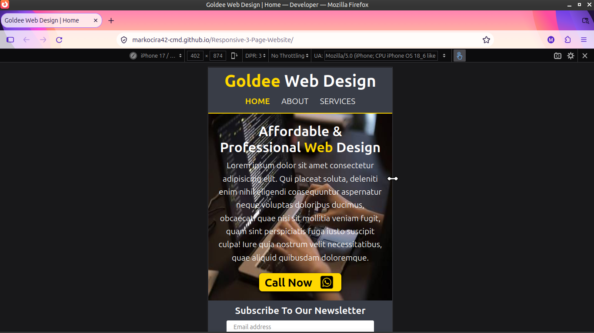

Built a responsive three-page website using HTML and CSS to practice multi-page layouts, semantic markup, and mobile-first design. Includes a responsive navigation bar, Flexbox/Grid layouts, and consistent styling across desktop and mobile.

#### Live link

https://markocira42-cmd.github.io/Responsive-3-Page-Website/

#### Desktop View

#### Moblie View

